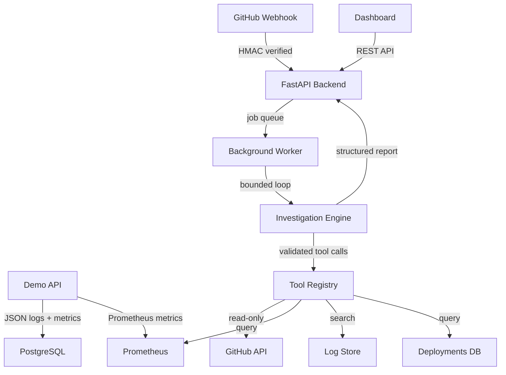

# OpenSRE AI

An open-source AI Site Reliability Engineering agent that investigates CI/CD pipeline failures and runtime incidents using real evidence from monitoring data, logs, and GitHub Actions.

## Features

- **CI/CD pipeline failure investigation** — GitHub Actions workflow runs, jobs, failed logs, commits, changed files
- **Runtime incident investigation** — Prometheus metrics, application logs, service health, deployment records, runbooks
- **Bounded AI investigation loop** — configurable limits on iterations, tool calls, wall time, context size
- **Evidence-backed reports** — every claim references actually-retrieved evidence; invalid references are stripped
- **Local-first** — runs on a laptop with 8 GB RAM; no cloud account required
- **Security-focused** — HMAC webhook verification, repository allowlists, secret redaction, per-source tool allowlists

## Architecture



## Technology Stack

| Layer | Technology |
|-------|-----------|
| Frontend | Next.js 15, TypeScript, Tailwind CSS |
| Backend | Python 3.12+, FastAPI, Pydantic v2 |
| Database | PostgreSQL 16, SQLAlchemy 2.x, Alembic |
| Job queue | PostgreSQL-backed (no Redis) |
| AI providers | Ollama (local) or any OpenAI-compatible hosted endpoint |
| Monitoring | Prometheus, prometheus-client |
| Infrastructure | Docker, Docker Compose |

## Prerequisites

- Docker 24+ and Docker Compose 2+
- Python 3.12+ (for local development without Docker)
- Node 22+ (for frontend development)
- (Optional) Ollama for local LLM inference

## Quick Start

### Docker Compose (recommended)

```bash
cp .env.example .env
docker compose up -d --build
```

Then open:
- Dashboard: http://localhost:3000
- API docs: http://localhost:8000/docs
- Prometheus: http://localhost:9090

### Local development

```bash
# Backend
python3 -m venv .venv
.venv/bin/pip install -e ".[dev]"
make db-up          # run migrations
make dev-api        # start API on :8000
make dev-demo       # start demo API on :8001
make dev-dashboard  # start dashboard on :3000
```

## Runtime Incident Demo

1. Start the stack (`docker compose up -d --build`)
2. Verify health: `curl http://localhost:8000/api/v1/health`
3. Generate traffic: `python scripts/generate_traffic.py --seconds 60 --rps 5`
4. Trigger a fault via the Demo Lab page or API:
   ```bash
   curl -X POST http://localhost:8000/api/v1/demo/scenarios/pool-exhaustion/trigger \
     -H "X-API-Key: change-me-admin-key"
   ```
5. Watch real errors in logs and Prometheus metrics
6. Start an investigation from the dashboard or API
7. View the evidence-backed report
8. Reset: `curl -X POST http://localhost:8000/api/v1/demo/reset -H "X-API-Key: change-me-admin-key"`

## CI/CD Incident Demo

1. Create a repository from `examples/github-demo-repo/`
2. Set `GITHUB_TOKEN` and `GITHUB_ALLOWED_REPOS` in `.env`
3. Set `GITHUB_WEBHOOK_SECRET` in `.env`
4. Expose the backend with ngrok: `ngrok http 8000`
5. In GitHub repo Settings -> Webhooks, add `https://<ngrok-url>/api/v1/webhooks/github`
6. Set the webhook secret to match `GITHUB_WEBHOOK_SECRET`
7. Push to main or trigger `workflow_dispatch` with `demo_mode: fail-test`
8. The backend receives the webhook, creates an incident, and investigates

## AI Model Configuration

### Ollama (local)

```bash
# Start Ollama (optional profile)
docker compose --profile ollama up -d ollama
docker compose exec ollama ollama pull llama3.1:8b
```

Set in `.env`:
```
LLM_PROVIDER=ollama
LLM_BASE_URL=http://localhost:11434
LLM_MODEL=llama3.1:8b
```

### Hosted (OpenAI-compatible)

Set in `.env`:
```
LLM_PROVIDER=hosted
LLM_BASE_URL=https://openrouter.ai/api/v1
LLM_MODEL=meta-llama/llama-3.1-8b-instruct
LLM_API_KEY=sk-or-...
```

Any OpenAI-compatible endpoint works (vLLM, llama.cpp server, Together, Groq, etc.).

## Evaluation

```bash
make eval          # re-score all completed investigations
make eval-all      # same, with full output
```

The evaluation harness uses deterministic checks (no LLM judge):
- Root-cause keyword matching
- Evidence-reference validity
- Tool-call validity (allowlist enforcement)
- Evidence relevance

## API Overview

| Endpoint | Description |
|----------|-------------|
| `GET /api/v1/health` | Health and dependency status |
| `GET /api/v1/incidents` | List incidents (paginated, filterable) |
| `POST /api/v1/incidents` | Create an incident |
| `GET /api/v1/incidents/{id}` | Get incident details |
| `POST /api/v1/incidents/{id}/investigate` | Start an AI investigation |
| `GET /api/v1/investigations/{id}` | Get investigation with report |
| `GET /api/v1/investigations/{id}/events` | Investigation event timeline |
| `GET /api/v1/investigations/{id}/evidence` | Retrieved evidence |
| `POST /api/v1/demo/scenarios/{scenario}/trigger` | Trigger a demo fault (admin) |
| `POST /api/v1/demo/reset` | Reset demo lab (admin) |
| `GET /api/v1/demo/status` | Demo lab status |
| `POST /api/v1/webhooks/github` | GitHub webhook receiver |

## Security

See [SECURITY.md](SECURITY.md) for the full security model.

Key controls:
- HMAC-SHA256 webhook verification (constant-time)
- Repository allowlisting
- Per-source tool allowlists
- Secret redaction before model context
- Admin API key for demo/eval endpoints
- Read-only GitHub API access
- No arbitrary code execution

## License

[MIT](LICENSE)
